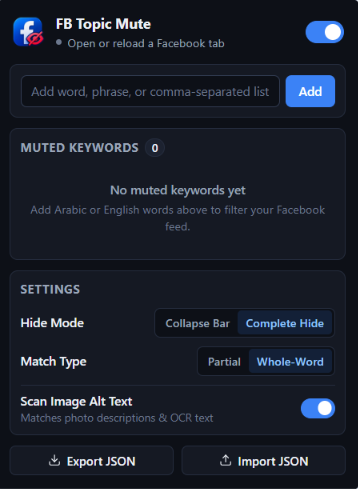

<p align="center">
  
</p>

<h1 align="center">FB Topic Mute</h1>

<p align="center">
  A lightweight, zero-dependency Manifest V3 browser extension for Chromium browsers (Chrome, Opera, Edge, Brave) that hides Facebook feed posts containing your muted words or phrases — with full Arabic and English normalization support.
</p>

<p align="center">
  <a href="#العربية---fb-topic-mute">العربية (Arabic Guide) ↓</a>
</p>

---

## Screenshot

<p align="center">
  
</p>

## Features

- **Arabic & English Normalization:**
  - Strips Arabic diacritics (Tashkeel) and Tatweel (`ـ`).
  - Normalizes Alef forms (`أ`, `إ`, `آ` → `ا`), Teh Marbuta (`ة` → `ه`), and Alef Maksura (`ى` → `ي`).
  - Case-insensitive English matching with whitespace cleanup.
- **Flexible Matching Modes:**
  - **Partial Match (Default):** Matches substrings (ideal for Arabic prefixes/suffixes like `الـ`, `و`, `بـ`).
  - **Whole-Word Match:** Unicode-aware word boundary matching (works accurately with both Arabic and English words).
- **Two React-Safe Hiding Modes:**
  - **Collapse Bar (Default):** Collapses matching posts into a slim bar showing the matched keyword with a **Show / Hide** toggle without removing React nodes.
  - **Complete Hide:** Completely hides matching posts via CSS (`display: none`).
- **Smart Facebook DOM Filtering:**
  - **Comment Isolation:** Ignores comment threads and replies so a comment never hides an unrelated post.
  - **Reels Shelf Isolation:** Hides only matching individual Reel cards inside a horizontal Reels shelf when possible.
  - **Optional Image Alt Scanning:** Matches photo descriptions and Facebook auto-OCR alt text while ignoring avatars, reaction icons, and emojis.
- **Fast & Real-Time:**
  - Batched `MutationObserver` + `WeakMap` signature caching for smooth scrolling.
  - Live updates across all open Facebook tabs without reloading the page.
- **Privacy First & Local Storage:**
  - Requests only the `storage` permission (no `tabs`, `scripting`, or `<all_urls>`).
  - Stores data locally in `chrome.storage.local` with **Export JSON / Import JSON** backup support.
  - Zero external CDNs, zero trackers, zero build step.

## Installation (Load Unpacked)

1. **Download the extension** using either option:
   - **Direct Download (Recommended for everyone):** Click the green **Code** button at the top of this page → **Download ZIP**, then extract the ZIP archive.
   - **Using Git:**
     ```bash
     git clone https://github.com/evile92/FB-Topic-Mute.git
     ```
2. Open your browser's Extensions page:
   - Chrome: `chrome://extensions`
   - Opera: `opera://extensions`
   - Edge: `edge://extensions`
   - Brave: `brave://extensions`
3. Enable **Developer mode** (top-right corner).
4. Click **Load unpacked** and select the extracted folder (the one containing `manifest.json`).
5. Open or refresh `facebook.com`, click the **FB Topic Mute** toolbar icon, and add your muted keywords.

## Known Limitations

- **Truncated text behind "See more":** Facebook does not load truncated post text into the page until you click **See more**; once expanded, the extension immediately scans and mutes the post if it matches.
- **Text embedded inside videos or images without alt text:** The extension cannot read text burned directly into video frames or images that have no `alt` description from Facebook.
- **Facebook DOM updates:** Facebook periodically changes its internal page structure. All selectors are centralized in `content/selectors.js` so updates can be applied cleanly in one place.

## Project Structure

```text
FB-Topic-Mute/
├── manifest.json            # Manifest V3 config (least-privilege permissions)
├── LICENSE                  # MIT License
├── utils/
│   └── textNormalizer.js    # Arabic/English normalization & Unicode matcher
├── content/
│   ├── selectors.js         # Centralized semantic Facebook DOM selectors
│   ├── content.js           # Observer, scanner, hiding engine & SPA handler
│   └── content.css          # Collapse bar & hidden post styles
├── popup/
│   ├── popup.html           # Dark-mode popup interface (LTR chrome + auto RTL tags)
│   ├── popup.css            # Popup styling
│   └── popup.js             # Keyword management, settings, stats & JSON backup
├── icons/                   # Extension icons (16, 48, 128px PNG) & logo.png
└── assets/                  # README screenshots
```

## License

This project is licensed under the [MIT License](LICENSE).

---

<div dir="rtl" align="right">

## العربية - FB Topic Mute

إضافة خفيفة ومجانية لمتصفحات كروميوم (Chrome و Opera و Edge و Brave) مبنية بمعيار **Manifest V3** وبدون أي مكتبات خارجية، تتيح لك إخفاء منشورات فيسبوك التي تحتوي على كلمات أو عبارات تحددها أنت (مشابهة لميزة كتم الكلمات في منصة X/Twitter)، مع دعم كامل للغتين العربية والإنجليزية.

### المميزات

- **دعم ذكي للغة العربية والإنجليزية:**
  - إزالة التشكيل والتطويل (`ـ`) تلقائياً قبل المطابقة.
  - توحيد أشكال الألف (`أ`، `إ`، `آ` ← `ا`) والتاء المربوطة (`ة` ← `ه`) والألف المقصورة (`ى` ← `ي`).
  - مطابقة غير حساسة لحالة الأحرف في الإنجليزية.
- **وضعان للمطابقة:**
  - **مطابقة جزئية (`Partial` — الافتراضي):** تطابق الكلمة حتى مع السوابق واللواحق العربية (مثل `الـ` و`و` و`بـ`).
  - **كلمة كاملة (`Whole-Word`):** مطابقة دقيقة بحدود Unicode تدعم العربية والإنجليزية.
- **وضعان آمنان لإخفاء المنشورات:**
  - **شريط الطي (`Collapse Bar` — الافتراضي):** يطوي المنشور إلى شريط رفيع يعرض الكلمة المحظورة مع زر **Show / Hide** لعرضه أو إخفائه مؤقتاً دون كسر التمرير اللانهائي لفيسبوك.
  - **إخفاء كامل (`Complete Hide`):** يخفي المنشور تماماً من الشاشة.
- **دقة في قراءة منشورات فيسبوك:**
  - **عزل التعليقات:** يتجاهل قسم التعليقات والردود حتى لا يتسبب تعليق أحد المستخدمين في إخفاء منشور غير مرتبط.
  - **عزل بطاقات Reels:** عند ظهور شريط Reels أفقي، يخفي البطاقة المطابقة فقط بدلاً من إخفاء الشريط بالكامل كلما أمكن.
  - **فحص وصف الصور (`Scan Image Alt Text`):** خيار لفحص النص البديل للصور ووصف فيسبوك التلقائي، مع استثناء الصور الشخصية والأيقونات والإيموجي.
- **تفاعل فوري وخصوصية تامة:**
  - إضافة أو حذف أي كلمة ينعكس فوراً على جميع تبويبات فيسبوك المفتوحة بدون تحديث الصفحة.
  - صلاحية واحدة فقط (`storage`) ولا تجمع أو ترسل أي بيانات خارج جهازك.
  - دعم **تصدير واستيراد JSON** لعمل نسخة احتياطية من قائمة كلماتك.

### طريقة التثبيت

1. **حمّل الإضافة** بإحدى الطريقتين:
   - **التحميل المباشر (موصى به للجميع):** اضغط على زر **Code** الأخضر في أعلى الصفحة ← اختر **Download ZIP**، ثم فك الضغط عن الملف.
   - **عبر Git (للمطورين):** نفّذ الأمر `git clone https://github.com/evile92/FB-Topic-Mute.git`
2. افتح صفحة الإضافات في متصفحك:
   - في Chrome: `chrome://extensions`
   - في Opera: `opera://extensions`
   - في Edge: `edge://extensions`
   - في Brave: `brave://extensions`
3. فعّل خيار **وضع المطور (Developer mode)**.
4. اضغط على **تحميل إضافة غير مضغوطة (Load unpacked)** واختر المجلد بعد فك الضغط (المجلد الذي يحتوي على ملف `manifest.json`).
5. افتح فيسبوك أو حدّث الصفحة، ثم اضغط على أيقونة **FB Topic Mute** وأضف الكلمات التي تريد كتمها (يمكنك إدخال أكثر من كلمة بفواصل `,` أو `،`).

### القيود المعروفة

- **النص المخفي خلف زر "عرض المزيد" (See more):** لا يقوم فيسبوك بتحميل باقي النص داخل الصفحة إلا بعد الضغط على الزر؛ وبمجرد الضغط على "عرض المزيد" تلتقط الإضافة النص تلقائياً وتخفي المنشور إذا احتوى على كلمة محظورة.
- **النصوص المدمجة داخل الفيديو أو الصور بدون وصف بديل:** لا يمكن قراءة النصوص المرسومة مباشرة داخل الفيديو أو الصور التي لا يوفّر لها فيسبوك نصاً بديلاً (`alt`).
- **تحديثات فيسبوك الدورية:** قد يغيّر فيسبوك بنية الصفحة من وقت لآخر، لذلك تم تجميع كل محددات العناصر في ملف واحد (`content/selectors.js`) لتسهيل تحديثها بسرعة عند الحاجة.

### الرخصة

هذا المشروع مرخص بموجب رخصة [MIT License](LICENSE).

</div>
